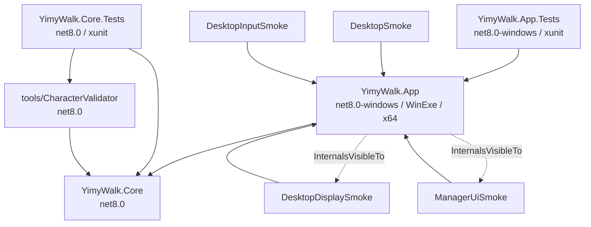

# YimyWalk 仓库索引

> **用途**：把「要改什么 → 去哪个文件 → 读哪份文档」压缩成一页，减少每次都全仓库搜索的成本。
> **读法**：先读 [`AGENTS.md`](../AGENTS.md)（约束与命令），再用本页定位；具体行为以源码为准。
> **维护约定**：新增/删除/改名 顶层目录、项目、枢纽文件、`scripts/*.ps1`、`tools/*` 时**必须同步本页**。
> **最后核对**：2026-11-01，维护分支 `codex/bootstrap`、版本 0.1.14（审查起点 `7a0fb13`）；当前行为与四档验证见 [`MAINTENANCE.md`](MAINTENANCE.md)，本页只维护导航。
> **快速接手**：[当前维护记忆](MAINTENANCE.md) → [最新交接](STATUS.md) → [本轮问题处置](reviews/2026-11-01-remediation.md)。首次接手还需读取 [原始需求](PROJECT_SPEC.md)。

按任务读取：[Core §3](#3-yimywalkcore-模块地图) · [App §4](#4-yimywalkapp-模块地图) · [测试 §5](#5-测试地图testsyimywalkcoretests) · [工具/脚本 §6](#6-工具与脚本入口) · [文档 §7](#7-文档地图) · [命令 §9](#9-常用命令) · [改动落点 §11](#11-改动落点-checklist)。不必每次加载全部模块表。

---

## 0. 30 秒建立世界观

YimyWalk 是一个**离线运行的 Windows x64 桌面 2D 宠物引擎**。核心卖点是数据驱动的角色格式：往 `Characters/<id>/` 丢一张 3×3 透明 PNG，就能得到会发呆 / 走 / 跳 / 坠落 / 攀爬 / 被拖拽 / 说话的桌宠，**不需要改代码**。

三条不能忘的设计前提：

1. **一个宠物实例 = 一个透明分层窗口**，所有窗口由**同一个 `AppHost` 进程**管理（不每宠一进程，也不是全屏覆盖层）。
2. **可测试的核心（`YimyWalk.Core`）与 Windows 平台代码（`YimyWalk.App`）严格分层**，Core 不碰 WinForms/Win32。
3. **桌面行为只能用真机验收**，Core 测试 / 截图 / 发布包自检都不能替代（详见 [§10](#10-验证状态与边界)）。

---

## 1. 顶层地图

| 路径 | 作用 | 什么时候要动它 |
| --- | --- | --- |
| `src/YimyWalk.Core/` | 纯逻辑：角色加载、物理、状态机、实例、设置 schema、显示器契约 | 改玩法/物理/角色格式/设置字段（**不碰 UI 和 Win32**） |
| `src/YimyWalk.App/` | Windows 外壳：窗口、渲染、托盘、管理器、设置文件、启动入口 | 改窗口行为、DPI、菜单、UI、持久化 |
| `tests/YimyWalk.Core.Tests/` | Core 的平台无关 xUnit 测试 | 任何 Core 行为改动都应在此加断言 |
| `tests/YimyWalk.App.Tests/` | Windows 适配层 xUnit：设置、资源、日志、架构、ACL 与宿主隔离；不替代桌面验收 | 改 Windows 适配和失败清理 |
| `tools/CharacterValidator/` | 唯一进 `YimyWalk.sln` 的工具；角色校验 + 预览图，**同时被测试项目当库引用** | 改角色校验诊断/预览输出 |
| `tools/` 下的 4 个 smoke 工具（`DesktopSmoke`、`DesktopDisplaySmoke`、`DesktopInputSmoke`、`ManagerUiSmoke`） | 桌面验收工具，**不在 .sln 里**，只由 `scripts/*.ps1` 构建 | 扩展桌面验收矩阵 |
| `scripts/` | 可复现入口：环境检查、构建、测试、发布、角色校验、桌面 smoke | 加/改自动化步骤 |
| `Start-YimyWalk.ps1` | 根目录及发布包可用的启动包装，调用 `run-yimywalk.ps1` | 改启动诊断或入口兼容性 |
| `Characters/` | 随包初始角色（`slime`、`咿米_Yimy`、`咿米_Line`），每个只有 `sprite.png` | 换/加初始角色 |
| `examples/character-template/` | 作者模板（含 `character.json` + `dialogue.txt`） | 改角色格式文档的配套示例 |
| `docs/` | 规格、架构、状态交接、测试入口、角色格式、上游审计、索引 | 见 [§7](#7-文档地图) |
| `licenses/` + `THIRD_PARTY_NOTICES.md` | 第三方许可与署名 | 增删依赖时必须同步 |
| `Directory.Build.props` | 统一版本号真源（默认 `0.1.14`，脚本从此读取，可显式 `-Version` 覆盖） | 改默认版本 |
| `global.json` | 锁定 SDK `8.0.425`（`rollForward: latestPatch`） | 升级 SDK 时 |
| `YimyWalk.sln` | 只含 Core / Core.Tests / App / App.Tests / CharacterValidator **5 个项目** | 新项目入解决方案 |
| `.github/workflows/dotnet.yml` | CI：`codex/bootstrap` 的 push/PR 上 Ubuntu + Windows 矩阵；Ubuntu Core，Windows Core/App + smoke 编译 | 改 CI 范围（注意：CI **不跑** Windows 桌面 smoke） |

---

## 2. 项目依赖图



- NuGet：`Core` → StbImageNext **1.0.0**；`App` → AntdUI **2.4.12**；`Tests` → xunit 2.9.3 / xunit.runner.visualstudio 2.8.2 / Microsoft.NET.Test.Sdk 18.10.1 / coverlet.collector 6.0.0。
- PNG 解码通过 Core 的受限 `PngImage` 边界；ImageSharp 已移除。App.Tests 为 Windows xUnit 项目，引用 App（包含 Core）。
- **没有循环依赖**；`Core` 不引用 WinForms/WindowsBase/PresentationCore（由测试强制，见 §5）。

---

## 3. `YimyWalk.Core` 模块地图

| 文件 | 主要类型 | 职责 |
| --- | --- | --- |
| `Imaging/PngImage.cs` | `PngImage`、`Rgba32` | 受限 PNG 解码（CRC / 解压预算）、RGBA 像素与 PNG 预览输出 |
| `Simulation/PetLimits.cs` | `PetLimits` | 最终像素上限、有效缩放、统一行走速度上限 |
| `Characters/CharacterLoader.cs` | `CharacterLoader`（静态，持有**全部校验上限常量**） | 读 PNG 头 → 校验尺寸/Alpha/像素数 → 切 3×3 帧 → 读可选 `character.json`、`dialogue.txt` |
| `Characters/CharacterDefinition.cs` | `CharacterDefinition` | 一个角色的**不可变共享数据**：帧、缩放、锚点、运动、台词、动画；含 `SelectFrame` |
| `Characters/CharacterFormat.cs` | `CharacterFrame/Movement/Defaults/Animation`、`Anchor`、`FrameKind`、`CharacterLoadException` | 角色格式的纯数据契约 |
| `Characters/CharacterCatalog.cs` | `CharacterCatalog`、`CharacterScanFailure` | 扫描角色根目录；**刷新失败保留上一份可用定义**；管理定义租约 |
| `Characters/DialogueSet.cs` | `DialogueSet` | 分组台词，组名大小写不敏感，缺组逐级回退内置默认 |
| `Display/DisplayContracts.cs` | `DisplayId`、`DisplayInfo`、`IDisplayProvider`、`DisplaySnapshot` | 显示器拓扑快照、按点/按 ID 解析、跨屏水平移动边界（全程保留负坐标） |
| `Display/SurfaceSelection.cs` | `SurfaceSelector`、`BallisticMotion`、`JumpTargetPlanner`、`WindowSurfaceCandidate`、`SurfaceSelection`、`JumpTarget` | 窗口顶面候选筛选、下落落点选择、跳跃弹道推进与可达性二分求解 |
| `Resources/DefinitionLease.cs` | `DefinitionLease`（嵌套 `LeaseHandle`） | **资源生命周期枢纽**：`ConditionalWeakTable` 实现多所有者 + 实例 + 渲染器引用计数，最后一个引用释放才回收 |
| `Settings/SettingsDocument.cs` | `SettingsDocument`（`sealed record`） | 已校验的不可变设置 DTO + 全部范围常量；未知属性拒绝 |
| `Startup/StartupDiagnostics.cs` | `StartupDiagnostics`、`StartupDiagnostic` | 启动前角色可用性检查 → `CHARACTER_ROOT_MISSING` / `CHARACTERS_EMPTY` / `CHARACTERS_INVALID` |
| `Simulation/SimulationContracts.cs` | `WorldRect`、`IWorldSurface`、`IRandomSource`、`PetState`、`FacingDirection` | 世界/随机/表面抽象与枚举 |
| `Simulation/PetState.cs` | — | ⚠️ **空文件**（只有注释）；`PetState` 枚举实际在 `SimulationContracts.cs` |
| `Simulation/PetEngine.cs` | `PetEngine` | **物理 + 自主行为枢纽**：Idle / Walk / JumpCharge / Jump / Apex / Fall / Climb / TopWalk / Eat / Dragged |
| `Simulation/PetInstance.cs` | `PetInstance` | 单实例可变状态：脚底位置、速度、朝向、状态计时、Hunger/Boredom、行为覆盖、缩放覆盖 |
| `Simulation/PetSession.cs` | `PetSession` | **实例所有权枢纽**：定义注册/替换、创建/删除/清空、暂停、喂食、事件、可选 `HardLimit` |
| `Simulation/PetBehaviorOverrides.cs` | `BooleanOverride`、`PetBehaviorOverrides` | 单实例「跟随/开/关/自定义」三态解析与钳制 |
| `Simulation/DialogueScheduler.cs` | `DialogueScheduler`、`DialogueBubble` | 气泡准入：全局可见上限、每宠冷却、过期回收 |
| `Simulation/VirtualFoodSystem.cs` | `VirtualFoodSystem`、`VirtualFoodTarget`、`VirtualFoodState` | 程序生成食物目标的生成/认领/消费/超时；通过目标意图让引擎移动，由 PetSession 统一推进 |
| `Simulation/BatchRequestQueue.cs` | `BatchRequestQueue<T>` | 平台无关的延迟工厂队列（`Enqueue/Drain(max)/Cancel`） |
| `Properties/AssemblyInfo.cs` | — | `InternalsVisibleTo("YimyWalk.Core.Tests")` |

---

## 4. `YimyWalk.App` 模块地图

> ⚠️ **本程序集内所有类型都是 `internal`**，唯一入口是 `Program.Main`。

| 文件 | 职责 |
| --- | --- |
| `Program.cs` | STA 入口：`ApplicationConfiguration.Initialize()` → `AppHost.Start` → `Application.Run`；异常映射退出码 1/2 |
| `Host/AppHost.cs` | **应用总线枢纽**：持有 surface / 窗口注册表 / catalog / session / settings / tray / manager / dialogue / 虚拟食物；16 ms 计时循环、批量创建、前台轮询、统一 `Dispose` |
| `Host/DesktopWorldSurface.cs` | `IWorldSurface` 实现：显示器快照（1 s 刷新，1280×720 回退）+ 转发窗口顶面查询 |
| `Host/WindowsDisplayAdapter.cs` | `Screen.AllScreens` + `GetDpiForMonitor` → `DisplaySnapshot` |
| `Host/WindowSurfaceResolver.cs` | 250 ms 单调时间驱动的 `EnumWindows` 快照；过滤 desktop shell / 宿主自身 / 过小窗口；遮挡判定；**从不移动或关闭用户窗口** |
| `Host/PetWindowRegistry.cs` | `Guid → PetWindow` 映射；Add 时 Show + 首帧刷新，Remove 时 Dispose |
| `Host/BatchCreationQueue.cs` | 1 ms 计时器，每 tick `Drain(8)`，维护 Pending/Active 计数 |
| `Host/RuntimeServices.cs` | `IMonotonicClock` / `StopwatchClock`、`IAppLog` / `AppLog`：可注入单调时间、有限且不含用户内容的运行日志 |
| `Host/SystemRandomSource.cs` | `Random.Shared` → `IRandomSource` |
| `Rendering/FrameSurfaceCache.cs` | 按 (定义, 帧, 镜像, 缩放) 缓存位图 + Alpha 掩码；每个 `RenderedSurface` 持定义租约，调用方必须持 `SurfaceLease`；缓存 64 MiB，按真实尺寸建键并淘汰未用项，在用引用保持有效 |
| `Rendering/LayeredWindowRenderer.cs` | 分步检查句柄与 `UpdateLayeredWindow`；失败仍释放已获得资源，错误由宿主诊断处理 |
| `Rendering/BubbleRenderer.cs` | 咿米皮肤九宫格、独立文字、按 DPI / 工作区限宽换行与定位；`BubbleArtwork` 由窗口负责释放 |
| `Settings/SettingsStore.cs` | `%LocalAppData%\YimyWalk\settings.json`（+`.bak`/`.tmp`）、`File.Replace` 原子替换、主文件损坏回退备份 |
| `Settings/SettingsSaveCoordinator.cs` | 300 ms 合并写入；暴露 Applied/Saving/Saved/Failed + Error + Retry |
| `Startup/StartupFailure.cs` | MessageBox + `startup-error.log`；退出码 2（已知诊断）/ 1（未知异常） |
| `Windows/PetWindow.cs` | 每实例一个分层无激活窗口：选帧/呈现、跟踪所在屏 DPI、**Alpha 命中测试**、拖拽与抛掷测速 |
| `Windows/BubbleWindow.cs` | 咿米逐像素 Alpha 气泡窗口：整窗穿透 / 不激活，跟随宠物与 DPI，钳制到所在屏工作区 |
| `Windows/FoodWindow.cs` | 20×20 无激活且整窗输入透明的食物窗口，金色圆点随消耗缩放 |
| `Windows/NativeMethods.cs` | **唯一 Win32 P/Invoke 集中地** |
| `UI/ManagerForm.cs` | 主菜单外壳：200 px 侧栏、5 页按需创建并缓存、可见时 200 ms 刷新；启动隐藏，普通关闭隐藏回托盘，显式退出由宿主处理 |
| `UI/ManagerPage.cs` | 页面基类 + 标题/卡片布局辅助（标题间距按字体实测高度计算） |
| `UI/UiTheme.cs` | 颜色/字体/间距常量 + AntdUI 控件工厂 |
| `UI/TrayIconHost.cs` | `NotifyIcon` + 右键菜单（打开管理器 / 隐藏 / 显示 / 清空 / 退出） |
| `UI/AppIcon.cs` | 读取嵌入资源 `yimywalk.ico`（EXE / 管理窗口 / 托盘图标三处一致） |
| `UI/PetListProjection.cs` | 以 `Guid` 为主键的行模型与选中态投影 |
| `UI/InstanceSettingState.cs` | 生成「跟随全局 / 实例自定义 / 受全局限制」等中文来源说明 |
| `UI/Controls/CharacterFramePreview.cs` | 单帧 idle(index 0) 静态预览（按原分辨率取帧 + NearestNeighbor） |
| `UI/Pages/OverviewPage.cs` | 总览：活动/待创建计数、快捷 1/10/50/100、暂停、喂食、虚拟食物、隐藏/显示 |
| `UI/Pages/PetsPage.cs` | 桌宠：列表 + 单实例覆盖（走动/气泡/活跃度/缩放/三种欲望） |
| `UI/Pages/CharactersPage.cs` | 角色：列表、详情、idle 预览、刷新角色、设为下次创建默认角色 |
| `UI/Pages/InteractionsPage.cs` | 互动：全局默认（走动/气泡/饥饿/外部反馈/活跃度）+ 气泡总闸（优先级为运行级，设置实际会持久化） |
| `UI/Pages/SettingsPage.cs` | 设置：全局缩放、首选显示器、窗口顶部落脚、保存状态与重试 |
| `Resources/` | `yimywalk.ico`、`icon_yimy.png`、`logo.png`；`Dialogue/yimy-bubble.png` 为嵌入的咿米气泡原画 |

---

## 5. 测试地图（`tests/YimyWalk.Core.Tests/`）

| 文件 | 覆盖内容 |
| --- | --- |
| `SmokeTests.cs` | ⭐ **架构铁律**：Core 不引用 WinForms / WPF / System.Drawing.Common，也不声明 P/Invoke；App 的对应约束在 App.Tests |
| `CharacterFormatTests.cs` | 3×3 协议、非 3 整除/全透明/损坏/超大/无 Alpha PNG 一律拒绝 |
| `CharacterLoaderTests.cs` | 仅 `sprite.png` 时走安全默认；可选配置不改变帧协议 |
| `CharacterCatalogTests.cs` / `CharacterRefreshTests.cs` | 坏包刷新保留上一份可用定义；被移除角色不能新建实例 |
| `LoaderValidationTests.cs` | 错误消息含完整目录；缩放导致超大帧被拒；台词分组回退与不可变快照 |
| `CharacterValidatorTests.cs` | 校验器诊断文本、坏配置/坏 UTF-8/坏路径不抛异常、**不覆盖角色文件**、无效角色不写预览 |
| `DisplayContractTests.cs` | 负坐标显示器回溯、首选显示器失效回退、按所在屏工作区落点、跨屏水平边界 |
| `SurfaceSelectionTests.cs` | 最近可见顶面；拒绝隐藏/最小化/陈旧/排除/零面积/被遮挡/最大化/脚已越过；越界回退地面 |
| `PetPhysicsTests.cs` | 生成下落 → 落地转 Idle、边界与 wrap、跨屏间隙、Apex 判定、拖拽禁物理、上抛帧序、走出支撑面坠落、显示器丢失重定位、实例状态隔离 |
| `AutonomousMovementTests.cs` | 自主行走/蓄力跳/快速跳、蓄力与起跳速度单调、暂停冻结、攀爬起止与反向 |
| `AutonomousBoundaryTests.cs` | 窗口跳跃可达性边界、横向速度不超行走上限、目标消失不改弧线 |
| `WindowJumpRegressionTests.cs` | 满欲望跨真实桌面高度、弹道推进与规划一致、零重力匀速、不可达拒绝、跳过当前支撑窗口 |
| `PetNeedsTests.cs` | Hunger/Boredom 推进与喂食、速率有界、角色配置增长率生效 |
| `VirtualFoodTests.cs` | 单一认领与消耗缩没、认领中断释放、目标上限与超时 |
| `DialogueSchedulerTests.cs` | 缺组回退、每宠冷却、全局可见上限与过期、`Clear` 清空冷却 |
| `PetBehaviorOverrideTests.cs` | 三态布尔覆盖、活跃度继承/钳制/重置、实例缩放与全局独立、禁走动不禁重力与拖拽 |
| `PetSessionTests.cs` | `CreateMany`/`Clear`、事件解绑、定义替换语义、`HardLimit` 仅为测试能力 |
| `ResourceLifecycleTests.cs` | 目录/会话/渲染器共享同一生命周期、无引用版本释放、句柄幂等 |
| `SettingsDocumentTests.cs` | 默认值安全、非法值回默认、未知属性拒绝、UTF-8 往返、旧设置补默认 |
| `BatchCreationTests.cs` | 队列按上限分批抽取、`Cancel` 丢弃未执行的工厂 |
| `StartupDiagnosticsTests.cs` | 缺目录/空目录/全无效/部分无效四种启动诊断 |
| `TestSpriteFactory.cs` | 测试用 PNG 生成辅助（非测试类） |

测试规模与通过记录属于带日期的证据，见 [当前摘要](MAINTENANCE.md#当前验证摘要) 和 [最新交接](STATUS.md)。本表描述测试意图；未列出的组合场景不能由测试名推定为已覆盖。

---

### 新增回归与 Windows App 测试

Core 新增 `MaintenanceRegressionTests.cs`（租约 / 扫描事务 / 无聊 / 限制）、`FoodMotionRegressionTests.cs`（暂停 / 覆盖 / 速度 / 消费）、`PngBoundaryTests.cs`（像素往返 / CRC / 截断），`BatchCreationTests.cs` 补充紧凑大请求。App 的 `BubbleRenderingTests.cs` 验证皮肤透明度、边角不拉伸、文字换行 / 限高、DPI 和负坐标定位。

`tests/YimyWalk.App.Tests/`：`SettingsStoreTests.cs`（两条写入路径的备份保全）、`RenderingTests.cs`（预算 / 引用 / GDI 失败清理）、`ArchitectureTests.cs`（可见性 / P/Invoke / 有限日志）、`HostIsolationTests.cs`（临时设置 / 失败取消）、`CharacterPermissionTests.cs`（实际 ACL 拒读）、`AssemblyInfo.cs`（Windows 资源断言串行化）。

## 6. 工具与脚本入口

### 工具

| 工具 | 参数 | 用途 |
| --- | --- | --- |
| `tools/CharacterValidator` | `<角色目录> [--preview <png>] [--reference <png>] [--help]`；退出码 0/1/2 | 角色校验 + 3×3 预览图 / 网格锚点参考图 |
| `tools/DesktopSmoke` | `<rounds 1–20> <role> [landing] [targeted]` | 真实创建/清空 1/10/50/100 窗口，输出 CPU_S/工作集/私有字节/托管堆/句柄/USER/GDI |
| `tools/DesktopDisplaySmoke` | `<characterRoot> [--rounds 1–100] [--inventory]`；**<2 块扩展显示器 → `UNVERIFIED` + 退出码 2** | 多显示器/DPI 矩阵：每屏生成落地行走跳跃、透明穿透、实体命中、跨屏拖拽 |
| `tools/DesktopInputSmoke` | 无参数 | 真实鼠标输入 + 主菜单/托盘生命周期 |
| `tools/ManagerUiSmoke` | `[--baseline]` / `[--preview-pixels]` / `[--bubble-skin]` | 管理界面结构、像素与咿米气泡渲染 / 真机窗口回归 |
| `tools/GenerateTestCharacters.ps1` | `[-Root <dir>]` | 生成测试用 cat/slime 角色图 |

`ManagerUiSmoke` 没有单独的 PowerShell 包装。先执行 `.tools/dotnet/dotnet.exe build tools/ManagerUiSmoke/ManagerUiSmoke.csproj -c Release -p:Platform=x64`，再在可见桌面执行 `.tools/dotnet/dotnet.exe tools/ManagerUiSmoke/bin/x64/Release/net8.0-windows/ManagerUiSmoke.dll --baseline`；不传参数运行完整模式，`--preview-pixels` 运行像素回归。

只核对源码兼容性时，四个 smoke 项目可分别执行同样的 `dotnet build ... -p:Platform=x64`，无需启动程序。编译不算桌面验收。完整宿主 smoke 使用注入的临时设置目录；隔离边界见 [TESTING](TESTING.md#桌面工具的设置隔离边界)。`--bubble-skin` 入口不创建 AppHost，不读取用户设置；详见 [气泡样式](YIMY_VISUAL_STYLE.md)。

### 脚本（`scripts/`）

| 脚本 | 参数 | 用途 |
| --- | --- | --- |
| `verify-environment.ps1` | — | 打印 OS/Git/SDK 版本；**仓库内出现 `vendor/esheep` 时故意抛错** |
| `bootstrap-dotnet.ps1` | `[-InstallDir] [-Channel 8.0]` | 下载安装工作区本地 SDK 到 `.tools/dotnet` |
| `build-yimywalk.ps1` | `-Version -PublishPath [-Configuration] [-DotnetPath]` | restore → Core 测试 → 自包含单文件 x64 发布 → 复制 `Characters/`、许可、manifest、checksums |
| `publish-yimywalk.ps1` | `-OutputPath -Version [...]` | 同上的发布入口，默认输出 `artifacts/publish/yimywalk-win-x64` |
| `test-yimywalk.ps1` | — | 运行 Release Core + Windows App 测试（**硬编码 `.tools\dotnet\dotnet.exe`**） |
| `run-yimywalk.ps1` | `[-Configuration] [-Wait] [-PublishPath]` | 启动前预检（`PUBLISH_MISSING` / `PUBLISH_INCOMPLETE` / `CHARACTER_ROOT_MISSING` / `CHARACTERS_EMPTY` / `CHARACTERS_INVALID` / `RUNTIME_MISSING`） |
| `validate-character.ps1` | `-Path [-PreviewPath] [-ReferencePath]` | 包装 `CharacterValidator`（需先 restore） |
| `test-release-package.ps1` | `-Path -Version` | 校验发布包清单、角色与 SHA-256 |
| `desktop-smoke.ps1` | `[-Rounds 1–20] [-Role] [-Landing] [-Targeted]` | 包装 `DesktopSmoke` |
| `desktop-input-smoke.ps1` | 无参数 | 包装 `DesktopInputSmoke` |
| `desktop-display-smoke.ps1` | `[-Rounds 1–100] [-InventoryOnly] [-LogPath]` | 包装 `DesktopDisplaySmoke` |
| `get-yimywalk-version.ps1` | — | 从 Directory.Build.props 读取默认版本，供 build / publish / 验包共用 |
| `generate-app-icon.ps1` | `[-SourcePath icon_yimy.png] [-OutputDirectory]` | 由 `icon_yimy.png` 生成多尺寸 `yimywalk.ico` |

---

## 7. 文档地图

| 文档 | 权威性 | 什么时候读 / 改 |
| --- | --- | --- |
| `docs/PROJECT_SPEC.md` | **用户原始需求全文**（M0–M4 分阶段） | 需求有疑问时读；**不要按实现进度改写它** |
| `docs/reviews/2026-11-01-remediation.md` | R01–R13 的修正、测试与硬件未验证边界 | 本轮处置详细落点；后续行为变更仍写 STATUS |
| `docs/MAINTENANCE.md` | **当前维护记忆**，可更新短摘要 | 快速接手，查看当前有效行为、四档状态、下一项任务；与 STATUS 同步 |
| `docs/reviews/2026-11-01-project-review.md` | **本轮审查快照**：覆盖范围、实跑、四项沙盒复现、R01–R13 待办、旧评审纠正 | 处理稳定性问题时按 ID 定位；修复后在 STATUS 登记 |
| `docs/TECHNICAL_REVIEW.md` | **历史快照**（2026-10-16）：功能盘点与重构建议 | 只追溯当时判断；部分结论已由本轮审查纠正，不能当作当前缺陷或授权方案 |
| `docs/INDEX.md`（本页） | 结构索引 | 定位代码/脚本/文档；结构变动时同步 |
| `docs/STATUS.md` | **交接证据来源**，最新条目在最上方，旧条目限于原日期和场景 | 先读最新条目，按功能定位相关历史；改行为或建立维护基线后追加带日期条目 |
| `docs/ARCHITECTURE.md` | 当前分层决策、真实类型和资源边界 | 决定代码该放哪一层时读 |
| `docs/CHARACTER_FORMAT.md` | 角色包格式的**对外契约**（supported / planned 已区分） | 改角色格式或写文档时读 |
| `docs/TESTING.md` | 验收入口与 Windows 桌面验收矩阵 | 决定"怎么算通过"时读 |
| `docs/YIMY_VISUAL_STYLE.md` / `docs/artwork/yimy-bubble-prompt.txt` | 咿米主题、气泡原画来源 / hash / 提示词、切图与复核入口 | 改气泡外观或替换皮肤时读 |
| `docs/UPSTREAM_AUDIT.md` | eSheep 上游审计结论（固定提交、许可、代码路径） | 需要复核上游时读；**在仓库外取源码** |
| `docs/superpowers/specs/*.md`（6 篇） | 各功能的设计稿（历史） | 追溯某个功能的原始设计意图 |
| `docs/superpowers/plans/*.md`（13 篇） | 各阶段的实施计划（历史） | 追溯实施步骤与当时的决策 |
| `docs/assets/*.png` | 可重复生成的预览/参考图 | 改角色格式文档配图 |
| `AGENTS.md` | **Agent 入口约束** | 每次开工先读 |
| `README.md` / `RELEASE_NOTES.md` / `THIRD_PARTY_NOTICES.md` | 对外说明 | 面向用户/发布的改动 |

---

## 8. 角色包格式入口

最小包是 `Characters/<id>/sprite.png`（带 Alpha 的 3×3 PNG）；可选 `character.json`、`dialogue.txt`。
字段、单位、限制和未支持项以 [CHARACTER_FORMAT](CHARACTER_FORMAT.md) 为详细落点；作者示例在 [character-template](../examples/character-template/README.md)。
初始角色事实和素材易错点见 [当前维护记忆](MAINTENANCE.md#接手时必须知道的当前行为)，避免在索引重复维护尺寸、哈希与默认值。

---

## 9. 常用命令

```powershell
# 本地 SDK 缺失或不满足 global.json 时安装（现有 SDK 可用时无需重装）
powershell -NoProfile -ExecutionPolicy Bypass -File scripts/bootstrap-dotnet.ps1

# 环境自检 / 依赖还原
powershell -NoProfile -ExecutionPolicy Bypass -File scripts/verify-environment.ps1
.\.tools\dotnet\dotnet.exe restore YimyWalk.sln

# Core + Windows App 自动测试（数量和耗时以本次输出为准）
.\.tools\dotnet\dotnet.exe test YimyWalk.sln --configuration Release --no-restore

# 完整发布（restore → test → 自包含单文件 x64 包）
powershell -NoProfile -ExecutionPolicy Bypass -File scripts/build-yimywalk.ps1 `
  -Version 0.1.14 -PublishPath artifacts/publish/yimywalk-win-x64
powershell -NoProfile -ExecutionPolicy Bypass -File scripts/test-release-package.ps1 `
  -Path artifacts/publish/yimywalk-win-x64 -Version 0.1.14

# 角色校验（带预览图）
powershell -NoProfile -ExecutionPolicy Bypass -File scripts/validate-character.ps1 `
  -Path .\Characters\slime -PreviewPath .\artifacts\slime-preview.png

# 桌面验收（必须可见且已解锁的桌面；多显示器矩阵需 ≥2 块扩展显示器）
powershell -NoProfile -ExecutionPolicy Bypass -File scripts/desktop-smoke.ps1 -Rounds 1 -Role slime
powershell -NoProfile -ExecutionPolicy Bypass -File scripts/desktop-input-smoke.ps1
powershell -NoProfile -ExecutionPolicy Bypass -File scripts/desktop-display-smoke.ps1 -Rounds 3
```

---

## 10. 验证状态与边界

本页不维护动态通过表。当前四档摘要见 [MAINTENANCE](MAINTENANCE.md#当前验证摘要)，命令与结果见 [STATUS](STATUS.md)，判据见 [TESTING](TESTING.md)。

必须区分：① 代码已实现 ② 构建通过 ③ Core 测试通过 ④ Windows 桌面已验证。构建、Core 测试、发布包自检、UI 截图均不能替代桌面验收；历史桌面结论只适用于原日期、代码和拓扑。

CI 只覆盖 Ubuntu 上的 restore/build/test；App 的 `EnableWindowsTargeting` 允许跨平台编译，不表示 Windows 适配已执行。桌面工具设置隔离和独立 Harness 的边界见 [TESTING](TESTING.md#桌面工具的设置隔离边界)。

---

## 11. 改动落点 checklist

| 我要改… | 主文件 | 必须同步 |
| --- | --- | --- |
| 角色格式 / 新增字段 | `Core/Characters/*` | `docs/CHARACTER_FORMAT.md`、`examples/character-template`、`CharacterLoaderTests`/`CharacterFormatTests` |
| 物理 / 状态机 / 自主行为 | `Core/Simulation/PetEngine.cs`、`PetInstance.cs` | 对应测试（`PetPhysicsTests`/`Autonomous*`/`WindowJumpRegressionTests`）、`docs/STATUS.md` |
| 窗口顶面 / 跳跃可达性 | `Core/Display/SurfaceSelection.cs` | `SurfaceSelectionTests`、`AutonomousBoundaryTests`、必要时 `WindowSurfaceResolver` |
| 显示器 / DPI | `Core/Display/DisplayContracts.cs`、`App/Host/WindowsDisplayAdapter.cs` | `DisplayContractTests`、`docs/STATUS.md`（桌面矩阵结论） |
| 设置字段 | `Core/Settings/SettingsDocument.cs` | `SettingsDocumentTests`、`App/UI/Pages/SettingsPage.cs`、`SettingsStore` |
| 资源释放 / 引用计数 | `Core/Resources/DefinitionLease.cs` | `ResourceLifecycleTests` |
| 气泡 / 台词 | `Core/Simulation/DialogueScheduler.cs`、`Core/Characters/DialogueSet.cs`、`App/Windows/BubbleWindow.cs`、`App/Rendering/BubbleRenderer.cs` | `DialogueSchedulerTests`、`BubbleRenderingTests`、`ManagerUiSmoke --bubble-skin`、[视觉说明](YIMY_VISUAL_STYLE.md)、UI「互动」页 |
| 虚拟食物 | `Core/Simulation/VirtualFoodSystem.cs`、`App/Windows/FoodWindow.cs` | `VirtualFoodTests` |
| 管理界面 | `App/UI/**` | `tools/ManagerUiSmoke`（布局断言 + 像素回归） |
| Win32 调用 | `App/Windows/NativeMethods.cs` | 检查是否真的被调用（见 §12 死代码清单） |
| 发布流程 / 包内容 | `scripts/build-yimywalk.ps1`、`publish-yimywalk.ps1`、`test-release-package.ps1` | `THIRD_PARTY_NOTICES.md`、`licenses/`、`RELEASE_NOTES.md` |

---

## 12. 维护状态与定位提醒

原审查 R01–R13 的实现修正与验证见 [修复记录](reviews/2026-11-01-remediation.md)；原审查保留为当时快照。当前摘要见 MAINTENANCE，后续改动按 ID 在 STATUS 交接。

- `PetState` 枚举仍位于 `SimulationContracts.cs`，同名 `PetState.cs` 只留历史注释；不是新功能入口。
- `HardLimit` 是可选公开 API，`WarningLimit` 是已序列化字段；生产未启用，兼容处理优先。
- `MainForm` 没有赋值，消息循环由 ApplicationContext 持有；管理器从 `_manager` 与托盘追踪。
- 工具有 App 内部接口与反射访问，重命名后需要单独构建 / 执行相关工具。
- 硬件验收仍欠双屏、负坐标真实布局、拔插、睡眠和长时资源；不因短期通过而关闭这些验证边界。
